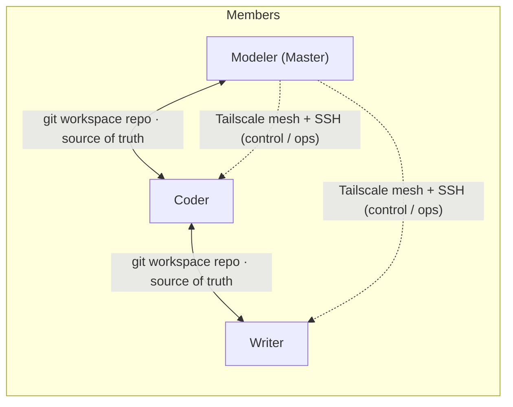

# MMCAS — Mathematical Modeling Competition Assistance System

**Make a three-member math-modeling team collaborate like a single mind.**

English | [中文](README.md)

[](LICENSE)


> Status: v1.3 completes dsh 0.2.1 compatibility for both CLI and Desktop (2026-10-29): merge-based profile config, one-click Desktop onboarding, `reviewer.json` migration, cold-session injection fixes → [ROADMAP.md](ROADMAP.md)

## What is this

MMCAS is a collaboration system for **three-member mathematical modeling competition teams**. Each member = **one human + one AI agent (dsh)**, and the human can intervene at any moment. Three roles, three responsibilities:

- **Modeler (Master)** — problem analysis, model selection, task-card creation & dispatching, final verdicts
- **Coder** — implementation, experiments & numerical computing, reproducibility
- **Writer** — paper writing & typesetting, figures/tables, number traceability

Three design principles: **human-in-the-loop** (any milestone can be paused or rewritten), **never silently lose data** (sync conflicts are surfaced for human arbitration), **zero-registration one-click install** (member machines register nothing external).

## Latest (v1.3)

- **Full dsh 0.2.1 support (CLI + Desktop)**: adapted to `0.2.1-rc.3` and the official DeepSeek Harness Desktop; profile, preset, and session-injection paths are unified.
- **One-click Desktop onboarding**: new `MMCAS-Desktop` launcher; isolated `DSH_HOME`, generated `profiles/desktop`, fixed panel port `19398`; profile updates are skipped safely while Desktop is running.
- **Merge-based profile config**: `write-config`, `switch-provider`, and `install-bridge` now merge entries into `cordis.patch.yml`, preserving dsh settings, installed plugins, and custom panel ports; re-running setup no longer wipes them.
- **0.2.1 standard preset sync**: adds `time-context` / `tool-schedule`; removes deprecated `backgroundMode`, `tool-ralph`, and old subagent rows.
- **Reviewer config migration**: the audit room now uses MMCAS-owned `reviewer.json`; legacy `settings.yaml` and `.imported` remain read-only compatible, so dsh's import step no longer drops the config.
- **Stability fixes**: cold-session `sessionController.prompt` now receives an `AbortSignal`; target sessions are selected by last event time; audit report names are unique; credentials `refs` are written safely; New Session matching follows the active locale.

## Features

- **Three role agents**: per-role persona, skills and tool boundaries.
- **Task-card DAG scheduling**: tri-state (todo/doing/done) + dependency gating (all deps done before start) + priority + atomic claiming; identical guardrails across CLI and panel; a task poller lets agents auto-claim ready work.
- **Shared workspace sync**: a private git repo is the single source of truth — workspace / task cards / memory files sync across all machines (daemon v0.2.1: auto commit/push, periodic pull, pre-commit health checks, conflict guard, stale-lock takeover).
- **Embedded dsh panel (CLI web + Desktop)**: Overview (devices / sync waterline / task poller), Task Board, Shared Memory, and Audit Room. Not a standalone service; follows the host theme (light/dark).
- **Cross-machine control**: Tailscale mesh + SSH ops channel; firewall restricts to the Tailscale CIDR, and the Master cannot be controlled back.
- **Multi-provider APIs**: official APIs and relays with multi-URL / multi-key switching; a built-in `codex-bridge` connects channels that only accept the standard Codex client.
- **Environment sync**: lockfile + three-party consent + P2P wheelhouse — the receiver aligns offline (uv diffs and installs only what is missing; no mirror touching).
- **Capability-layer skills**: per-role skill sets (native dsh skills, loaded on demand), distilled from MIT-licensed community projects (see `docs/capability-design.md`).
- **Sessions & context (v1.2)**: auto-claimed tasks open fresh sessions (one card, one session; rework resumes the original session); built-in compaction trio (auto / `/compact` / overflow recovery) plus token waterline guard.
- **Cross-end channel (v1.2)**: notices layer over the workspace git repo (urgent messages steer), stop directives, return cards (Slave→Modeler limited card creation), and rework flow (done→todo requires a reason).
- **Independent audit (v1.2)**: one-click third-party expert audits for models / code / final paper via the local codex-bridge, with budget guard (> ¥30 requires confirmation) and bridge health visibility.
- **Sync watchdog (v1.2)**: heartbeat is surfaced in the panel with stall alerts; launchers ensure the daemon is running.
- **Zero-registration one-click install**: one zip per member; double-click `setup.bat` and everything is automated (Tailscale up → SSH → portable Git/Node/uv → clone workspace → install dsh → generate config → autostart + shortcuts).

## Architecture



- **State sync**: private git repo over ssh.github.com:443 (stable across NAT)
- **Control channel**: Tailscale (WireGuard mesh; ACLs are the permission model)
- **Large files**: cloud drive (optional)
- **Desktop**: official DeepSeek Harness Desktop + isolated MMCAS `DSH_HOME`; launch via `MMCAS-Desktop`, panel port `19398`

## Repository layout

```
docs/               Design docs & credential-exposure registry (template)
specs/              Task-card spec
packages/
  core/             Shared core: sync daemon, profile merge, provider switcher, task-card guardrail, memory, SSH tools, setup
  dsh-panel-mmcas/  Embedded dsh panel plugin (CLI web + Desktop)
  modeler/          Modeler bundle (role.md + skills/)
  coder/            Coder bundle (role.md + skills/)
  writer/           Writer bundle (role.md + skills/)
  common/           Shared skills (written into the workspace repo .dsh/skills/, synced via git)
scripts/            Packing / offline vendor download / resource index / debugging scripts
```

## Quick start

```bash
# Build a member bundle (deployer side)
node scripts/pack.mjs --role <coder|writer|modeler>

# Fetch offline components (Node / PortableGit / Tailscale / uv)
bash scripts/download-vendor.sh
```

On a member machine: unzip the bundle → double-click `setup.bat` (≈9 fully automated steps, failures summarized) → daily use via the `MMCAS-Agent` desktop shortcut.

> Desktop: if the official DeepSeek Harness Desktop is installed, `setup.bat` also creates a `MMCAS-Desktop` shortcut (isolated DSH_HOME + panel port 19398). Fully quit the desktop app before launching or re-running configuration.

> Packing assumes the deployer has prepared local credential config (**all external, zero plaintext in the repo** — see the template in `docs/secrets-registry.md`; member credentials are pre-generated and injected by the deployer).

## Docs

| File | Content |
|---|---|
| `docs/design.md` | Architecture & design decisions (**single source of truth**; change the doc before the code) |
| `docs/capability-design.md` | Capability-layer (skills) design |
| `specs/task-card.md` | Task-card format & scheduling rules |
| `ROADMAP.md` | Version plan (mirrored to Milestones / Issues) |

## Roadmap (v1.3 summary)

- **Full dsh 0.2.1 support**: CLI + Desktop, merge-based profile config, standard preset sync
- **Desktop onboarding**: `MMCAS-Desktop`, isolated `DSH_HOME`, panel `19398`
- **Config migration**: `reviewer.json`, provider/bridge write active profile patch, legacy `settings.yaml` compatibility
- **Stability**: cold-session injection, target-session activity, audit report and credentials fixes
- **v1.4 candidates**: vector memory search, A2A, in-panel web terminal, more role skills & audit dimensions

See [ROADMAP.md](ROADMAP.md), [Milestones](https://github.com/dawn-471/MMCAS/milestones) and the Issues.

## Privacy & Security

- **Zero plaintext in the repo**: all credentials live outside (covered by `.gitignore`, `*.example` placeholders only); every new credential channel must be registered in `docs/secrets-registry.md` first.
- **Zero registration**: member machines register no external services; credentials are pre-generated and individually revocable by the deployer.
- **Compliance posture**: the system contains no automatic AI labeling/disclosure features.

## Acknowledgements

- [DeepSeek Harness (dsh)](https://github.com/deepseek-ai/deepseek-harness) — the agent runtime
- Parts of the capability-layer skills are distilled from MIT-licensed community projects (see `docs/capability-design.md`)

## License

[MIT](LICENSE)
