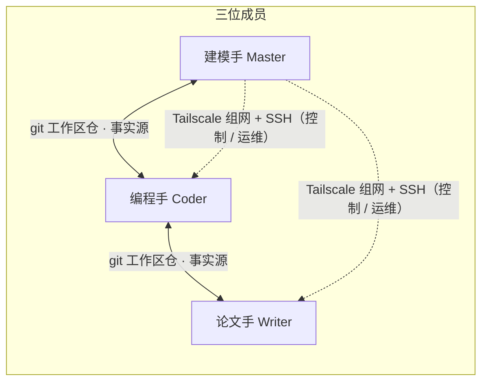

# MMCAS · 数学建模竞赛辅助系统

**Mathematical Modeling Competition Assistance System** —— 让三人数学建模小队像一个人一样协同。

[English](README.en.md) | 中文

[](LICENSE)


> 状态：v1.3 已完成 dsh 0.2.1（CLI + 桌面端）适配与全链路回归（2026-10-29）：profile 合并式配置、桌面端一键接入、reviewer.json 迁移、冷会话注入修复 → [ROADMAP.md](ROADMAP.md)

## 这是什么

MMCAS 是面向**三人数学建模竞赛小队**的协同工作系统。每位成员 = **1 个人类 + 1 个 AI Agent（dsh）**，人类随时可干预。三个角色各司其职：

- **建模手（Master）**：问题分析、模型选择、任务卡创建与分派、关键结论终审
- **编程手**：代码实现、实验与数值计算、结果可复现
- **论文手**：论文撰写与排版、图表整合、数字溯源

三条设计原则：**人类在环**（关键节点可随时卡停/改写）、**永不静默丢数据**（同步冲突显式上报，人类裁决）、**零注册一键安装**（成员机不注册任何外部账号）。

## 最新更新（v1.3）

- **dsh 0.2.1 全兼容（CLI + 桌面端）**：适配 `0.2.1-rc.3`，支持官方 DeepSeek Harness Desktop；统一修复 profile / preset / 会话注入链路。
- **桌面端一键接入**：新增 `MMCAS-Desktop` 启动器；使用 MMCAS 独立 `DSH_HOME`、自动生成 `profiles/desktop`、面板数据端固定 `19398`；桌面端运行中安全跳过 profile 更新。
- **profile 合并式配置**：`write-config`、`switch-provider`、`install-bridge` 改为按条合并 `cordis.patch.yml`，保留 dsh 设置、已装插件和自定义 panel 端口；重跑 setup 不再清空。
- **0.2.1 standard preset 同步**：加入 `time-context` / `tool-schedule`，移除已废弃的 `backgroundMode`、`tool-ralph` 与旧 subagent 配置行。
- **Reviewer 配置迁移**：审阅室改用 MMCAS 自有 `reviewer.json`；旧 `settings.yaml` 与 `.imported` 只读兼容，配置不再被 dsh 导入流程丢弃。
- **稳定性修复**：冷会话 `sessionController.prompt` 补 `AbortSignal`；目标会话按最后事件时间选择；审计报告文件名唯一化；credentials `refs` 安全写入；New Session 本地化匹配。

## 功能特性

- **三角色 Agent**：各角色独立的提示词（persona）、技能与工具边界。
- **任务卡 DAG 调度**：三状态（todo/doing/done）+ 依赖门控（deps 全 done 才可开始）+ 优先级 + 原子认领；CLI 与面板双通道同护栏；任务轮询器支持 Agent 自动接取就绪任务。
- **共享工作区同步**：git 私有仓为唯一事实源——工作区 / 任务卡 / 记忆文件三端自动同步（守护进程 v0.2.1：自动 commit/push、定时 pull、入库前体检、冲突守卫、过期锁接管）。
- **dsh 内嵌面板（CLI web + 桌面端）**：总控（成员设备 / 同步水位 / 任务轮询器）、任务看板、共享记忆、审计室；不是独立服务，随 dsh 侧栏运行，自动跟随宿主明暗主题。
- **跨设备控制**：Tailscale 组网 + SSH 运维通道；防火墙只放行 Tailscale 网段，Master 不可被反向控制。
- **多 API 来源**：官方 API 与中转站多 URL / 多 key，一键切换；内置 `codex-bridge` 让“仅接受标准 Codex 客户端”的通道也能接入。
- **环境同步**：lockfile + 三方同意 + P2P wheelhouse——接收端离线对齐，uv 自动 diff 只装缺失（不碰镜像源）。
- **能力层 skills**：每角色专属技能集（dsh 原生 skills 机制，按需加载）；蒸馏整合自社区 MIT 建模 skill 生态（见 `docs/capability-design.md`）。
- **会话与上下文（v1.2）**：任务自动接取即开新会话（一卡一会话、打回回原会话续做）；上下文压缩三件套（自动压缩 / `/compact` / 溢出恢复）+ token 水位守门。
- **跨端通道（v1.2）**：notices 消息层（工作区 git 通道，紧急消息 steer 打断）+ 停止指令 + 回程卡（Slave→Modeler 受限建卡）+ 打回机制（done→todo 必填原因）。
- **独立审计（v1.2）**：面板「审计室」一键对数学模型 / 代码成品 / 最终论文发起第三方专家审计（经本地 codex-bridge），含预算守门（> ¥30 需确认）与桥健康可见。
- **同步守护看门狗（v1.2）**：同步心跳显性化（面板心跳行 + 停滞告警）；启动器自动确保守护进程在跑。
- **零注册一键安装**：每成员一个 zip 包，解压双击 `setup.bat` 全自动（Tailscale 上线 → SSH → 便携 Git/Node/uv → 克隆工作区 → 安装 dsh → 生成配置 → 自启 + 快捷方式）。

## 架构



- **状态同步**：git 私有仓（走 ssh.github.com:443，NAT 环境下稳定）
- **控制通道**：Tailscale（WireGuard 组网，ACL 即权限）
- **大文件**：网盘（可选）
- **桌面端**：官方 DeepSeek Harness Desktop + MMCAS 独立 `DSH_HOME`；通过 `MMCAS-Desktop` 启动，面板数据端 `19398`

## 仓库结构

```
docs/               设计文档与凭证暴露面登记（模板）
specs/              任务卡规范
packages/
  core/             共享核心：同步守护、profile 合并、provider 切换、任务卡护栏、记忆、SSH 工具、setup
  dsh-panel-mmcas/  dsh 内嵌面板插件（CLI web + 桌面端）
  modeler/          建模手包（role.md + skills/）
  coder/            编程手包（role.md + skills/）
  writer/           论文手包（role.md + skills/）
  common/           三端共享 skills（写入工作区仓 .dsh/skills/，git 同步）
scripts/            打包 / 离线组件下载 / 资源索引生成 / 调试脚本
```

## 快速开始

```bash
# 生成成员包（部署者侧）
node scripts/pack.mjs --role <coder|writer|modeler>

# 下载离线组件（Node / PortableGit / Tailscale / uv）
bash scripts/download-vendor.sh
```

成员机：解压 zip → 双击 `setup.bat`（约 9 步全自动，失败自动汇总提示）→ 日常双击桌面 `MMCAS-Agent` 打开助手页面。

> 桌面端：如已安装官方 DeepSeek Harness Desktop，`setup.bat` 会额外生成 `MMCAS-Desktop` 快捷方式（独立 DSH_HOME + 面板端口 19398）；桌面端运行中请先完全退出，再启动/重跑配置。

> 打包假定部署者已准备本机凭据配置（**全部外置、仓库零明文**——所有凭证位置与处理方式见 `docs/secrets-registry.md` 模板；成员机凭据由部署者预生成注入）。

## 文档

| 文件 | 内容 |
|---|---|
| `docs/design.md` | 架构与设计决策（**唯一事实源**，改架构先改文档） |
| `docs/capability-design.md` | 能力层（skills）设计 |
| `specs/task-card.md` | 任务卡格式与调度规则 |
| `ROADMAP.md` | 版本规划（与 Milestones / Issues 同步） |

## Roadmap（v1.3 摘要）

- **dsh 0.2.1 全兼容**：CLI + 桌面端、profile 合并、standard preset 同步
- **桌面端接入**：`MMCAS-Desktop`、独立 `DSH_HOME`、面板 `19398`
- **配置迁移**：`reviewer.json`、provider/bridge 直写 profile patch、旧 `settings.yaml` 兼容
- **稳定性**：冷会话注入、目标会话活跃度、审计报告与 credentials 修复
- **v1.4 候选**：向量化记忆检索、A2A、面板内 Web 终端、更多角色技能与审计维度

详见 [ROADMAP.md](ROADMAP.md)、[Milestones](https://github.com/dawn-471/MMCAS/milestones) 与 Issues。

## 隐私与安全

- **仓库零明文**：所有凭证外置（`.gitignore` 覆盖 + `*.example` 占位）；新增凭证渠道须先登记 `docs/secrets-registry.md`。
- **零注册**：成员机不注册任何外部服务，凭据由部署者统一预生成、可单独吊销。
- **合规姿态**：系统内不含任何自动 AI 标注/声明功能。

## 致谢

- [DeepSeek Harness (dsh)](https://github.com/deepseek-ai/deepseek-harness) —— Agent 运行时
- 能力层部分技能蒸馏自社区 MIT 开源项目（明细见 `docs/capability-design.md`）

## License

[MIT](LICENSE)
